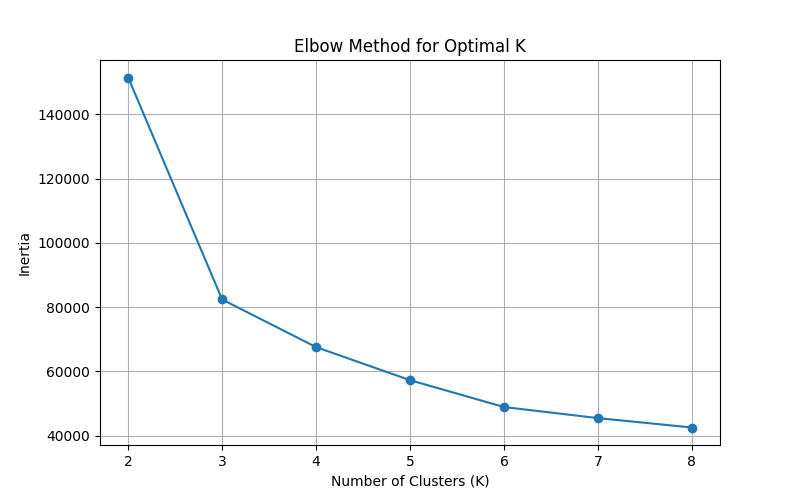
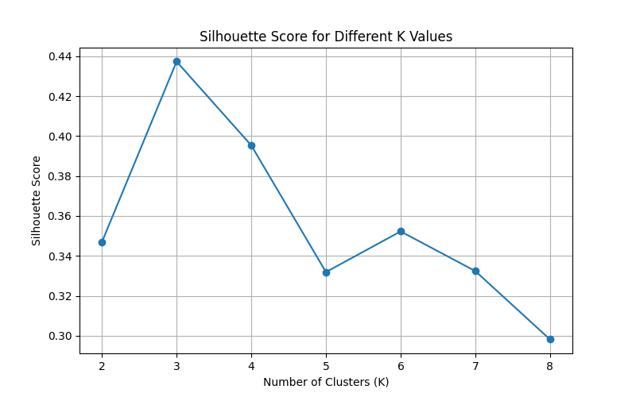
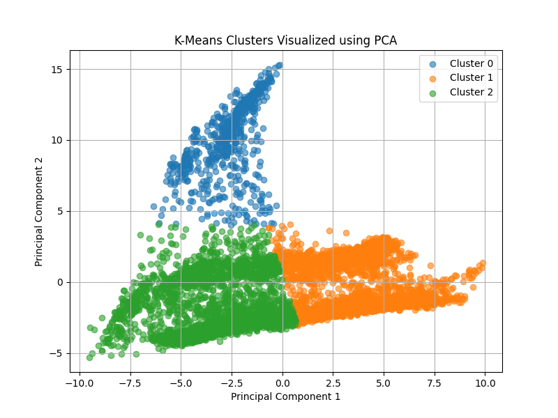
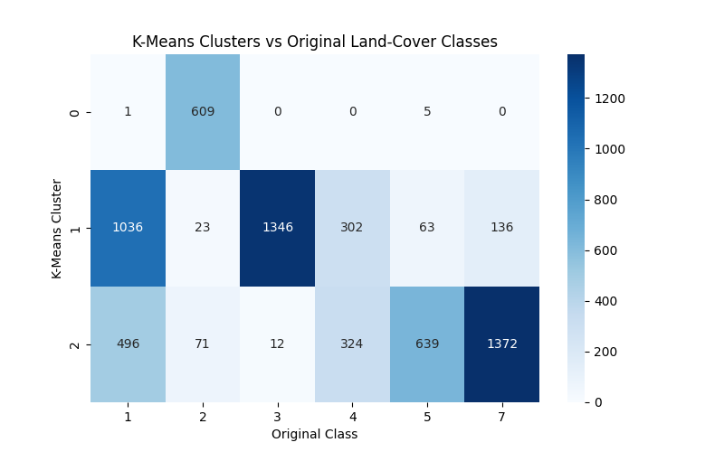

# 🛰️Satellite Land-Cover Clustering using K-Means

## 📌Project Overview

This project performs **Unsupervised Learning and Clustering Analysis** on the **Statlog (Landsat Satellite) Dataset**.

The main goal of this project is to identify meaningful groups or clusters within satellite-based land-cover data using the **K-Means clustering algorithm**.

Unlike supervised learning, clustering does not use the original land-cover class labels during the clustering process. Instead, the algorithm groups observations based on similarities in their numerical feature values.

This project was completed as part of **Week 3 – Unsupervised Learning and Clustering Analysis**.

The analysis includes data inspection, feature scaling, selection of the number of clusters, K-Means clustering, silhouette analysis, PCA-based visualization, cluster profiling, and comparison with the original land-cover classes.

---

## 🎯 Objectives

The main objectives of this project are:

* Understand the structure of a real-world satellite dataset.
* Perform initial dataset inspection.
* Check for missing values and duplicate records.
* Analyze the numerical feature ranges.
* Preprocess the data using feature scaling.
* Apply the K-Means clustering algorithm.
* Determine a suitable number of clusters.
* Use the Elbow Method to analyze clustering performance.
* Use Silhouette Score to evaluate cluster separation.
* Visualize clusters using Principal Component Analysis (PCA).
* Analyze the characteristics of each cluster.
* Compare discovered clusters with the original land-cover classes.
* Interpret the results and identify possible applications of satellite clustering.

---

# 📊Dataset

The dataset used in this project is the **Statlog (Landsat Satellite) Dataset** from the **UCI Machine Learning Repository**.

The dataset contains numerical information derived from satellite imagery. Each observation represents a satellite image sample described using multiple numerical attributes.

The original dataset also contains land-cover class information, which is used only for comparison after performing unsupervised clustering.

### Dataset Information

| Property | Value |
|---|---:|
| Number of Records | 6,435 |
| Number of Features | 36 |
| Target Variable | Land-cover Class |
| Missing Values | 0 |
| Duplicate Rows | 0 |
| Clustering Algorithm | K-Means |
| Selected Number of Clusters | 3 |

### Dataset Features

The dataset contains **36 numerical satellite-derived features**.

These features represent numerical measurements extracted from satellite observations and are used by the clustering algorithm to identify similarities between different observations.

The original dataset contains the following land-cover classes:

-> Class 1
-> Class 2
-> Class 3
-> Class 4
-> Class 5
-> Class 7

The original class labels were **not used to train K-Means**. They were used only after clustering to understand how the discovered clusters relate to the original land-cover categories.

---

# 🛠️Technologies Used

* Python
* Pandas
* NumPy
* Scikit-learn
* Matplotlib
* Seaborn
* UCI Machine Learning Repository
* VS Code
* Git
* GitHub

---

# 🔍Unsupervised Learning Methodology

The following steps were performed in this project:

### 1.Dataset Collection

The Statlog Landsat Satellite dataset was obtained from the **UCI Machine Learning Repository** using the `ucimlrepo` Python package.

The actual dataset was downloaded and saved locally inside the project `dataset` folder.

```python
from ucimlrepo import fetch_ucirepo

landsat = fetch_ucirepo(id=146)

X = landsat.data.features
y = landsat.data.targets
```

The feature data and target data were then saved as CSV files.

---

## 2.Initial Dataset Inspection

The dataset was inspected using:

```python
X.shape
X.head()
X.info()
X.isnull().sum().sum()
X.duplicated().sum()
```

The dataset contains:

- **6,435 observations**
- **36 numerical features**
- **0 missing values**
- **0 duplicate rows**

This indicates that the dataset was already structurally clean before clustering.

---

## 3.Feature Range Analysis

The minimum and maximum values of the features were examined using:

```python
X.describe().T[['min', 'max']]
```

The feature ranges are not identical.

Since K-Means uses distance calculations, features with larger numerical ranges could have a greater influence on the clustering process.

Therefore, feature scaling was required before applying K-Means.

---

# ⚙️Data Preprocessing

## 4.Feature Scaling

Standardization was performed using `StandardScaler`.

```python
from sklearn.preprocessing import StandardScaler

scaler = StandardScaler()
X_scaled = scaler.fit_transform(X)
```

Standardization transforms the features so that they are approximately centered around zero with a standard deviation of one.

### Why Scaling Was Required

K-Means calculates distances between observations.

If one feature has a much larger numerical range than another feature, it can dominate the distance calculation.

Scaling gives the numerical features a more balanced contribution during clustering.

The resulting scaled dataset contains:

```text
6,435 observations × 36 features
```

---

# 🤖 K-Means Clustering

## 5.Selecting the Number of Clusters

The K-Means algorithm requires the number of clusters `K` to be specified.

Instead of selecting a value randomly, several values of `K` were tested.

The project evaluated:

```text
K = 2, 3, 4, 5, 6, 7, 8
```

Two evaluation techniques were used:

- Elbow Method
- Silhouette Score

---

# 📉 6.Elbow Method

The Elbow Method was used to examine how the K-Means inertia changes as the number of clusters increases.

```python
inertia = []

for k in range(2, 9):
    kmeans = KMeans(
        n_clusters=k,
        random_state=42,
        n_init=10
    )

    kmeans.fit(X_scaled)
    inertia.append(kmeans.inertia_)
```

### Inertia Values

| Number of Clusters (K) | Inertia |
|---:|---:|
| 2 | 151500.80 |
| 3 | 82403.28 |
| 4 | 67579.83 |
| 5 | 57286.09 |
| 6 | 48926.04 |
| 7 | 45478.36 |
| 8 | 42552.01 |

As the number of clusters increases, the inertia decreases.

The Elbow Method was used as one of the references for selecting a reasonable clustering value.

### Visualization



---

# 📊 7.Silhouette Score

Silhouette Score was also calculated for different values of `K`.

```python
from sklearn.metrics import silhouette_score

silhouette_scores = []

for k in range(2, 9):

    kmeans = KMeans(
        n_clusters=k,
        random_state=42,
        n_init=10
    )

    labels = kmeans.fit_predict(X_scaled)

    score = silhouette_score(X_scaled, labels)
    silhouette_scores.append(score)
```

### Silhouette Scores

| Number of Clusters (K) | Silhouette Score |
|---:|---:|
| 2 | 0.3469 |
| 3 | 0.4373 |
| 4 | 0.3954 |
| 5 | 0.3319 |
| 6 | 0.3522 |
| 7 | 0.3324 |
| 8 | 0.2981 |

Among the tested values, **K = 3 produced the highest Silhouette Score of approximately 0.4373**.

Therefore, **3 clusters were selected** for the final K-Means model.

### Visualization



---

# 🤖 8.Final K-Means Clustering

The final K-Means model was created using three clusters.

```python
kmeans = KMeans(
    n_clusters=3,
    random_state=42,
    n_init=10
)

cluster_labels = kmeans.fit_predict(X_scaled)
```

The `random_state=42` value was used to make the clustering process reproducible.

The `n_init=10` parameter allows K-Means to run multiple initializations and select a solution with a better clustering objective.

---

# 📊Cluster Distribution

The final clustering produced three clusters.

| Cluster | Number of Observations |
|---:|---:|
| Cluster 0 | 615 |
| Cluster 1 | 2,906 |
| Cluster 2 | 2,914 |
| **Total** | **6,435** |

### Interpretation

Cluster 0 is considerably smaller than Clusters 1 and 2.

Clusters 1 and 2 contain similar numbers of observations, while Cluster 0 contains a much smaller group.

This indicates that the clustering algorithm identified one relatively compact group and two larger groups within the satellite observations.

---

# 📉 9.PCA Visualization

Since the dataset contains 36 features, directly visualizing all dimensions is difficult.

Therefore, **Principal Component Analysis (PCA)** was used to reduce the 36-dimensional feature space to two principal components for visualization.

```python
from sklearn.decomposition import PCA

pca = PCA(n_components=2)

X_pca = pca.fit_transform(X_scaled)
```

The resulting data contains:

```text
6,435 observations × 2 principal components
```

The first two principal components were used only for visualization.

### Explained Variance

The PCA explained variance values were calculated to understand how much information is represented by the two components.

```python
pca.explained_variance_ratio_
```

The two-dimensional PCA representation provides a simplified visual view of the clustering structure.

### Visualization



---

# 🔎 10.Cluster Characteristics

After clustering, the cluster labels were added to the original feature dataset.

```python
X_clustered = X.copy()

X_clustered["Cluster"] = cluster_labels

cluster_profile = X_clustered.groupby("Cluster").mean()
```

This allows the average feature values of each cluster to be examined.

The cluster profiles help identify how the groups differ from one another in terms of their satellite-derived numerical characteristics.

The cluster profiles were saved as:

```text
dataset/cluster_profiles.csv
```

### Purpose

Cluster profiling helps answer questions such as:

- What numerical characteristics are common in each cluster?
- Which features have higher average values in one cluster?
- How are the discovered groups different from each other?

This step is important because clustering should not only produce labels; the groups should also be interpreted.

---

# 🗂️ 11.Comparison with Original Land-Cover Classes

Although K-Means is an unsupervised learning algorithm, the original class labels available in the dataset were used after clustering for comparison.

```python
comparison = pd.crosstab(
    pd.Series(cluster_labels, name="Cluster"),
    y.iloc[:, 0]
)

print(comparison)
```

### Cluster vs Original Class

| Cluster | Class 1 | Class 2 | Class 3 | Class 4 | Class 5 | Class 7 |
|---:|---:|---:|---:|---:|---:|---:|
| 0 | 1 | 609 | 0 | 0 | 5 | 0 |
| 1 | 1036 | 23 | 1346 | 302 | 63 | 136 |
| 2 | 496 | 71 | 12 | 324 | 639 | 1372 |

### Interpretation

**Cluster 0** is highly concentrated in original Class 2, with **609 out of 615 observations** belonging to Class 2.

**Cluster 1** contains a mixture of several original classes. The largest groups are Class 3 and Class 1.

**Cluster 2** contains a large number of observations from Class 7 and Class 5, along with observations from other classes.

This comparison shows that the unsupervised clusters have different relationships with the original land-cover classes.

However, the original class labels were **not used during K-Means training**. They are shown only to help interpret the resulting clusters.

---

# 🔥 12.Cluster-Class Heatmap

A heatmap was created to visually compare the discovered clusters with the original land-cover classes.

```python
import seaborn as sns

sns.heatmap(
    comparison,
    annot=True,
    fmt="d",
    cmap="Blues"
)
```

### Purpose

The heatmap makes it easier to identify which original classes are concentrated within each discovered cluster.

### Visualization



---

# 📈 Key Findings

The main findings from the clustering analysis are:

1. The dataset contains **6,435 satellite observations**.
2. The dataset contains **36 numerical features**.
3. There are **no missing values**.
4. There are **no duplicate rows**.
5. Feature scaling was performed before applying K-Means.
6. K values from **2 to 8** were evaluated.
7. The highest Silhouette Score among the tested values was obtained for **K = 3**.
8. The Silhouette Score for K = 3 was approximately **0.4373**.
9. The final K-Means model produced **3 clusters**.
10. Cluster 0 contains **615 observations**.
11. Cluster 1 contains **2,906 observations**.
12. Cluster 2 contains **2,914 observations**.
13. Cluster 0 is highly concentrated in the original Class 2.
14. Cluster 1 contains substantial portions of original Classes 1 and 3.
15. Cluster 2 contains a large portion of original Class 7 and Class 5 observations.
16. PCA was used to visualize the 36-dimensional clustering results in two dimensions.
17. Cluster profiling was performed to understand the numerical characteristics of each cluster.

---

# 🌍 Possible Applications

Satellite clustering can be useful in several real-world areas.

### Land-Cover Analysis

Clustering can help group satellite observations with similar characteristics and support land-cover analysis.

### Remote Sensing

Unsupervised learning can be used to explore patterns in satellite observations when labelled data is limited.

### Agricultural Monitoring

Satellite data clustering can support the identification of areas with similar observed characteristics, which may assist agricultural monitoring workflows.

### Environmental Monitoring

Clusters can help organize large amounts of satellite observations into groups with similar numerical patterns.

### Geographic Information Systems

Clustering techniques can support exploratory analysis of satellite-derived data before applying more advanced supervised models.

These are potential applications of the clustering approach rather than direct conclusions from this particular dataset.

---

# 📁 Project Structure

```text
Week3_Satellite_Clustering/
│
├── clustering_analysis.py
├── README.md
│
├── dataset/
│   ├── landsat_features.csv
│   ├── landsat_target.csv
│   ├── landsat_clustered.csv
│   └── cluster_profiles.csv
│
└── visualization/
    ├── elbow_method.png
    ├── silhouette_scores.png
    ├── pca_clusters.png
    └── cluster_class_heatmap.png
```

---

# ▶️ How to Run the Project

### 1. Clone the repository

```bash
git clone <your-github-repository-link>
```

### 2. Open the project folder

```bash
cd Week3_Satellite_Clustering
```

### 3. Install the required libraries

```bash
pip install pandas numpy matplotlib seaborn scikit-learn ucimlrepo
```

### 4. Run the Python program

```bash
python clustering_analysis.py
```

The program will:

- Download the UCI Landsat Satellite dataset.
- Save the dataset locally.
- Inspect the dataset.
- Check missing values and duplicates.
- Scale the features.
- Test different values of K.
- Calculate inertia and Silhouette Scores.
- Apply K-Means clustering.
- Generate cluster profiles.
- Perform PCA.
- Compare clusters with original classes.
- Generate and save the visualizations.

---

# 📄 Generated Files

The project generates the following files.

### Dataset Files

```text
landsat_features.csv
landsat_target.csv
landsat_clustered.csv
cluster_profiles.csv
```

### Visualization Files

```text
elbow_method.png
silhouette_scores.png
pca_clusters.png
cluster_class_heatmap.png
```

These files provide the data and visual evidence required to understand and reproduce the clustering analysis.

---

# 📚 Dataset Source

The dataset is provided by the **UCI Machine Learning Repository**.

Dataset:

**Statlog (Landsat Satellite) Dataset**

UCI Dataset ID:

**146**

The dataset was accessed using the `ucimlrepo` Python package.

Official source:

https://archive.ics.uci.edu/dataset/146/statlog+landsat+satellite

---

# 🧠 Key Machine Learning Concepts

This project demonstrates several important unsupervised learning concepts:

### K-Means Clustering

Groups observations into a predefined number of clusters based on similarity.

### Feature Scaling

Standardizes numerical features so that different feature ranges do not disproportionately affect distance calculations.

### Elbow Method

Examines how clustering inertia changes as the number of clusters increases.

### Silhouette Score

Measures how well observations fit within their assigned clusters compared with other clusters.

### Principal Component Analysis

Reduces high-dimensional data into a smaller number of dimensions for visualization and analysis.

### Cluster Profiling

Examines the average feature values of each cluster to understand its characteristics.

---

# 📝 Conclusion

This project demonstrates how **Unsupervised Learning** can be applied to satellite-based data to discover meaningful groups without using class labels during the clustering process.

The Statlog Landsat Satellite dataset containing **6,435 observations and 36 numerical features** was inspected and found to contain no missing values or duplicate rows.

The features were standardized before applying K-Means because clustering is based on distance calculations. Different values of K were evaluated using the Elbow Method and Silhouette Score. Among the tested values, **K = 3 achieved the highest Silhouette Score of approximately 0.4373**, and three clusters were selected for the final analysis.

PCA was then used to visualize the resulting clusters in two dimensions. Cluster profiling was performed to understand the characteristics of the groups, and the discovered clusters were compared with the original land-cover classes for interpretation.

Overall, this project demonstrates a complete unsupervised learning workflow, including **data collection, preprocessing, feature scaling, cluster selection, K-Means clustering, evaluation, visualization, cluster interpretation, and comparison with reference labels**.

# 👩‍💻Author

**Keerthana Dhandapani**

B.E. Computer Science and Engineering Student  
Saveetha Engineering College
